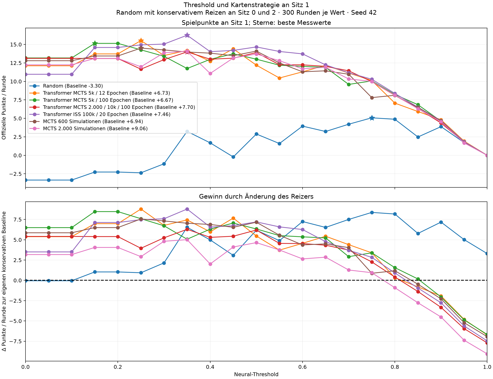
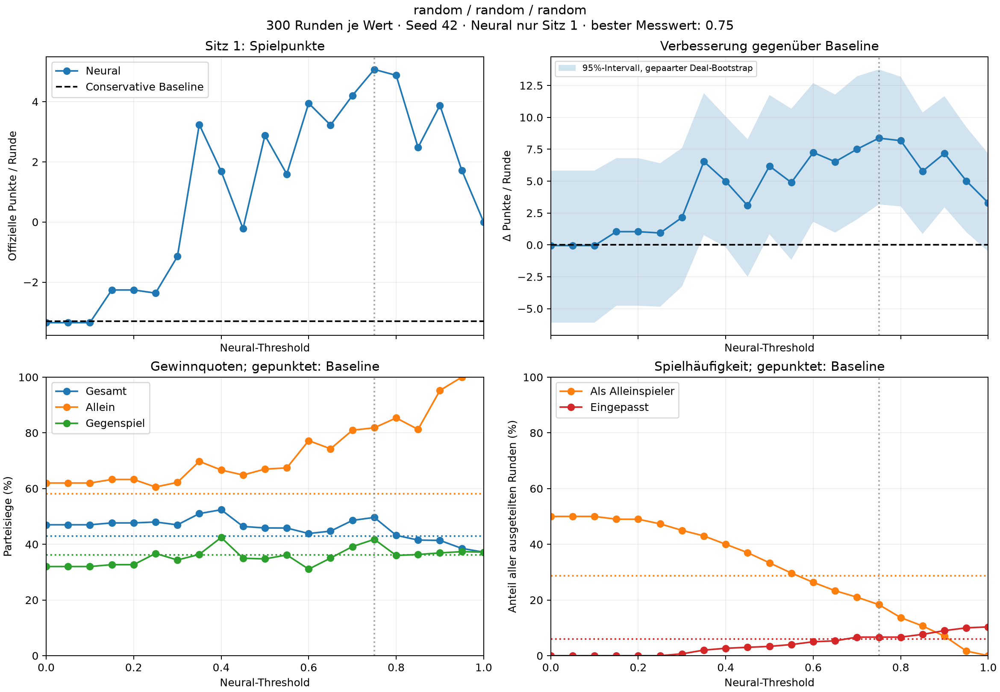
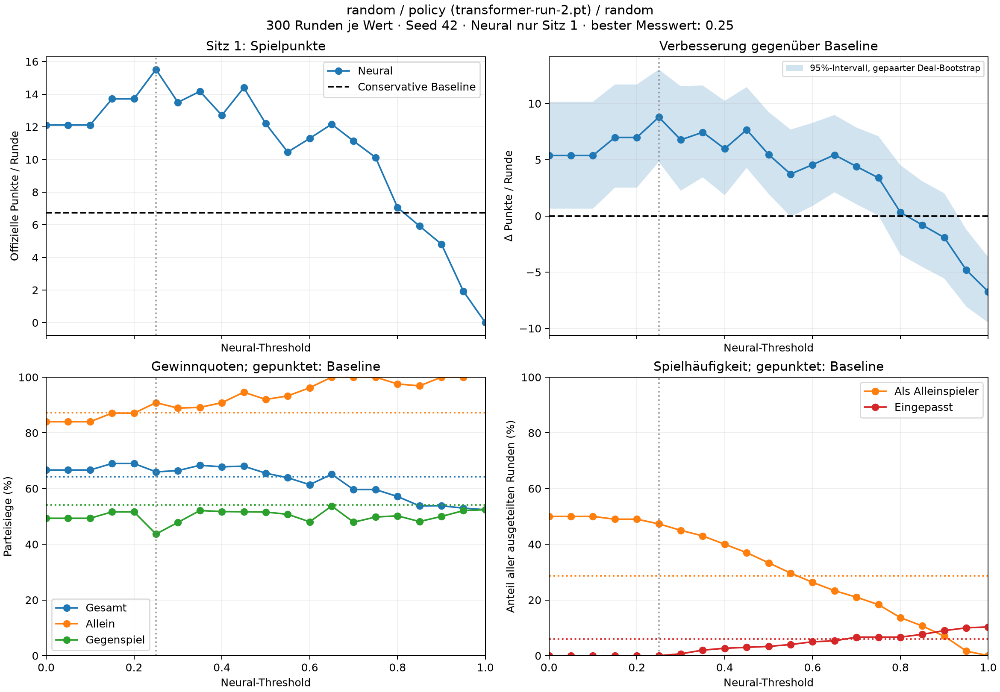
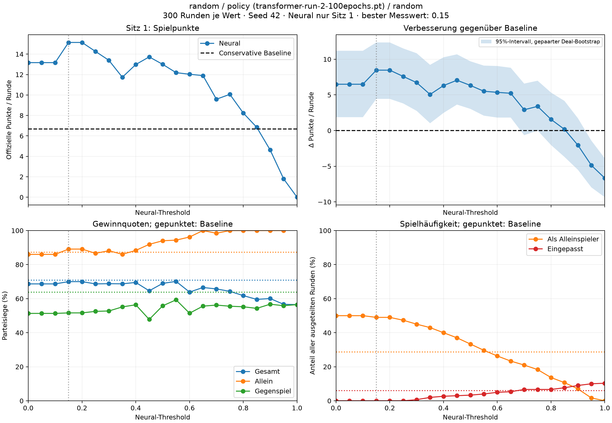
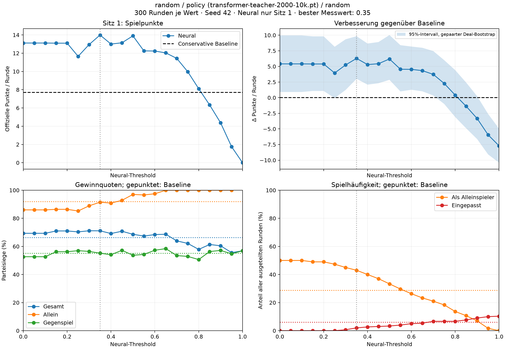
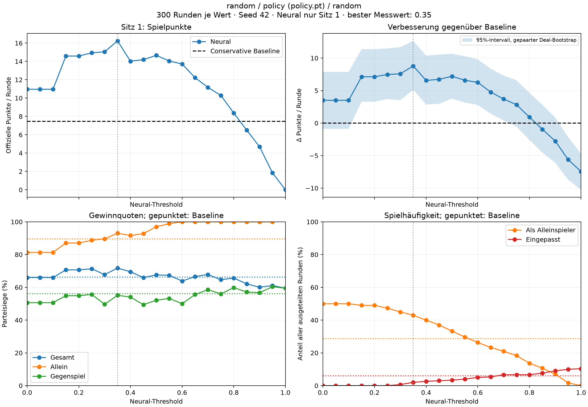
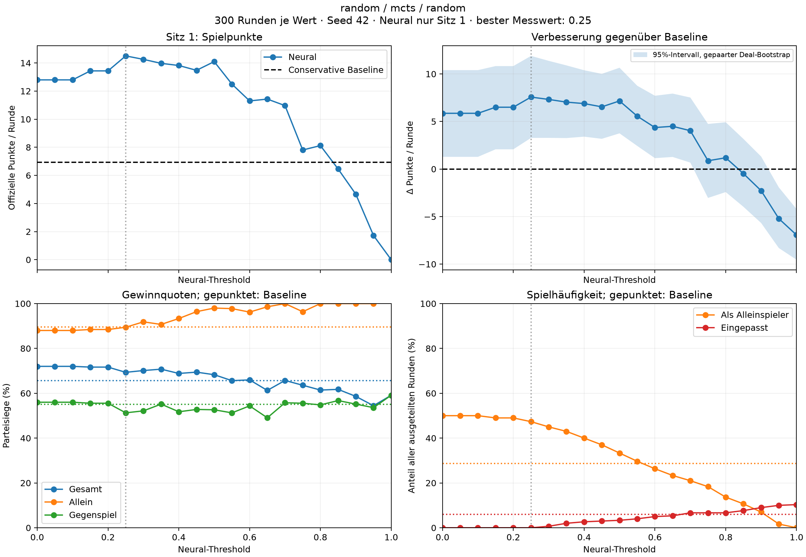
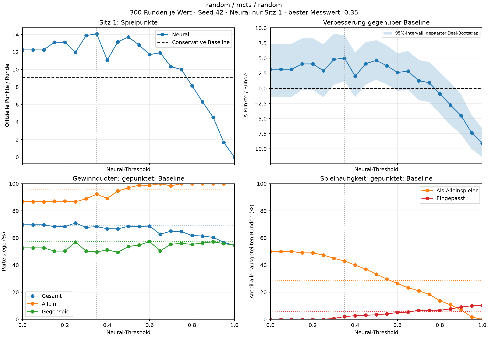

# Threshold-Vergleich an Sitz 1

300 Runden pro Wert, Seed 42; Random/conservative an Sitz 0 und 2. Je Variante eigene conservative Baseline. Alle Werte sind Messwerte dieses Sweeps, keine unabhängigen Testresultate.

## Gesamtvergleich

[Gesamtvergleich als PDF](comparison.pdf)

Oben stehen die offiziellen Punkte pro ausgeteilter Runde, unten die Differenz
zur jeweiligen konservativen Baseline. Sterne markieren die besten gemessenen
Schwellen. Die Gegner an Sitz 0 und 2 bleiben Random mit konservativem Reizen.

## Ergebnisse

| Kartenstrategie | Beste gemessene Schwelle | Conservative Punkte/Runde | Neural Punkte/Runde | Δ Punkte/Runde | 95%-Intervall Δ |
| --- | ---: | ---: | ---: | ---: | ---: |
| Random | 0.75 | -3.30 | +5.07 | +8.37 | [+3.17, +13.76] |
| Transformer MCTS 5k / 12 Epochen | 0.25 | +6.73 | +15.52 | +8.79 | [+4.81, +13.03] |
| Transformer MCTS 5k / 100 Epochen | 0.15 | +6.67 | +15.14 | +8.47 | [+4.44, +12.36] |
| Transformer MCTS 2.000 / 10k / 100 Epochen | 0.35 | +7.70 | +13.99 | +6.29 | [+3.02, +9.84] |
| Transformer ISS 100k / 20 Epochen | 0.35 | +7.46 | +16.24 | +8.78 | [+5.13, +12.65] |
| MCTS 600 Simulationen | 0.25 | +6.94 | +14.50 | +7.57 | [+3.27, +11.90] |
| MCTS 2.000 Simulationen | 0.35 | +9.06 | +14.07 | +5.01 | [+1.21, +8.80] |

Die Intervalle vergleichen jeden Messwert einzeln mit seiner Baseline und berücksichtigen die Auswahl aus 21 Schwellen nicht. Ein universell optimaler Threshold lässt sich daraus nicht ableiten. Schwellen auf neuen Seeds und größeren Stichproben prüfen.

Die README-Ratings mit 1.000 Runden bleiben ein separates Vergleichsverfahren.

## Einzelplots

Jeder Einzelplot zeigt Spielpunkte, die gepaarte Punktdifferenz zur Baseline
mit 95%-Bootstrap-Intervall, Parteisiegquoten und Spielhäufigkeit. Die senkrechte
gepunktete Linie markiert den besten Messwert der jeweiligen Variante.

### Random

[Einzelplot als PDF](random/threshold-sweep.pdf)

### Transformer MCTS 5k / 12 Epochen

[Einzelplot als PDF](policy-mcts-12/threshold-sweep.pdf)

### Transformer MCTS 5k / 100 Epochen

[Einzelplot als PDF](policy-mcts-100/threshold-sweep.pdf)

### Transformer MCTS 2.000 / 10k / 100 Epochen

[Einzelplot als PDF](policy-teacher-2000/threshold-sweep.pdf)

### Transformer ISS 100k / 20 Epochen

[Einzelplot als PDF](policy-iss/threshold-sweep.pdf)

### MCTS 600 Simulationen

[Einzelplot als PDF](mcts-600/threshold-sweep.pdf)

### MCTS 2.000 Simulationen

[Einzelplot als PDF](mcts-2000/threshold-sweep.pdf)

## Gespeicherte Daten

[Vergleichsdaten und Modellhashes](comparison.json) enthalten die Kurven und
Bestwerte aller Varianten. In jedem Variantenverzeichnis liegen außerdem
`summary.json` und `threshold-sweep.csv` mit den vollständigen Kennzahlen der
Baseline und aller 21 Schwellen. Die Einzelrunden bleiben lokal unter
`benchmark_runs/threshold-sweep-models-seed42/` beziehungsweise
`benchmark_runs/threshold-sweep-random-seed42/`.
