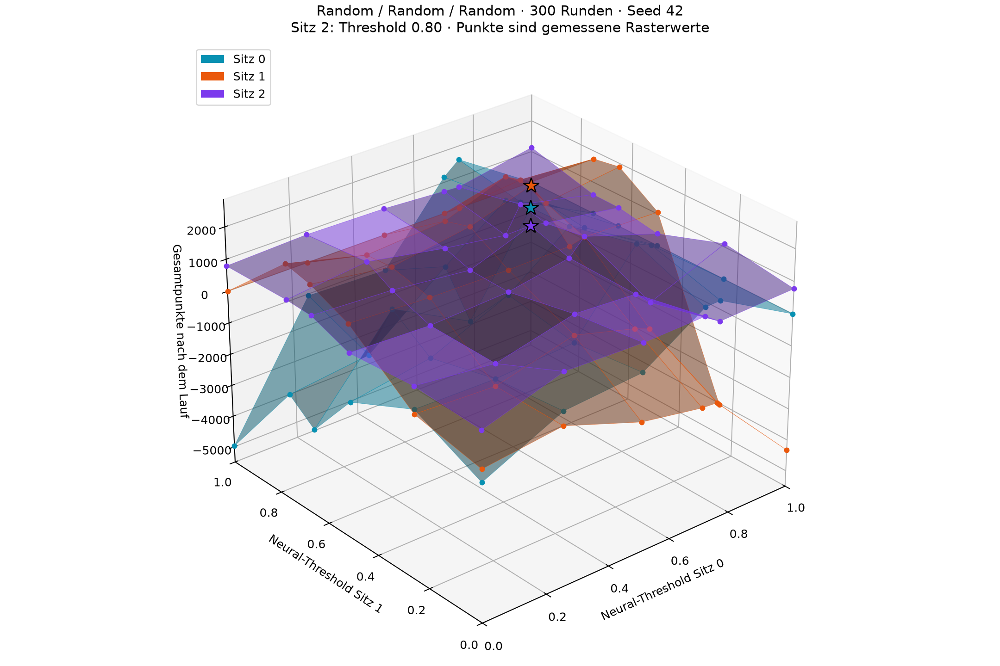
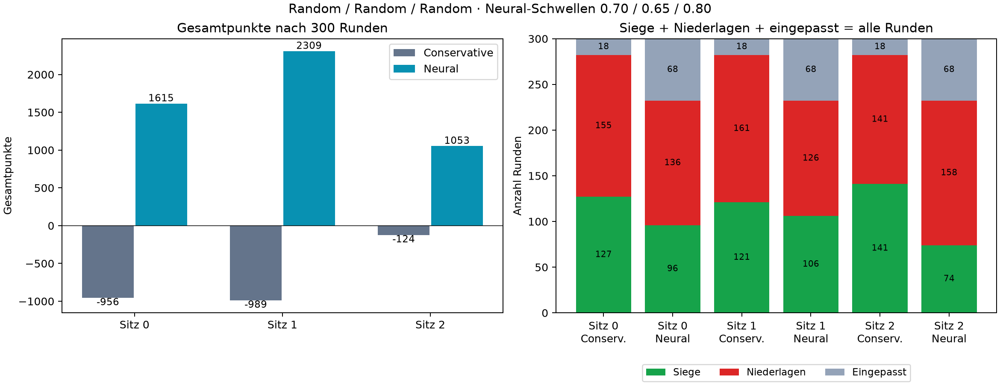
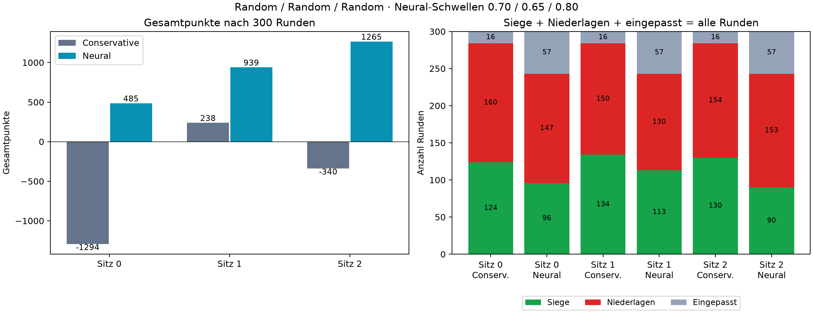
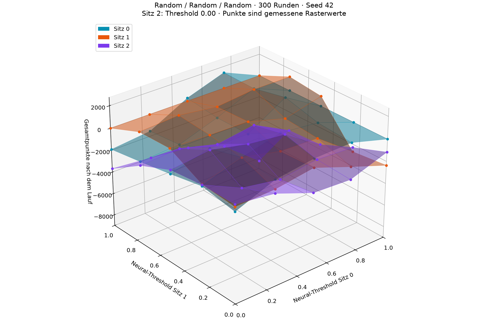
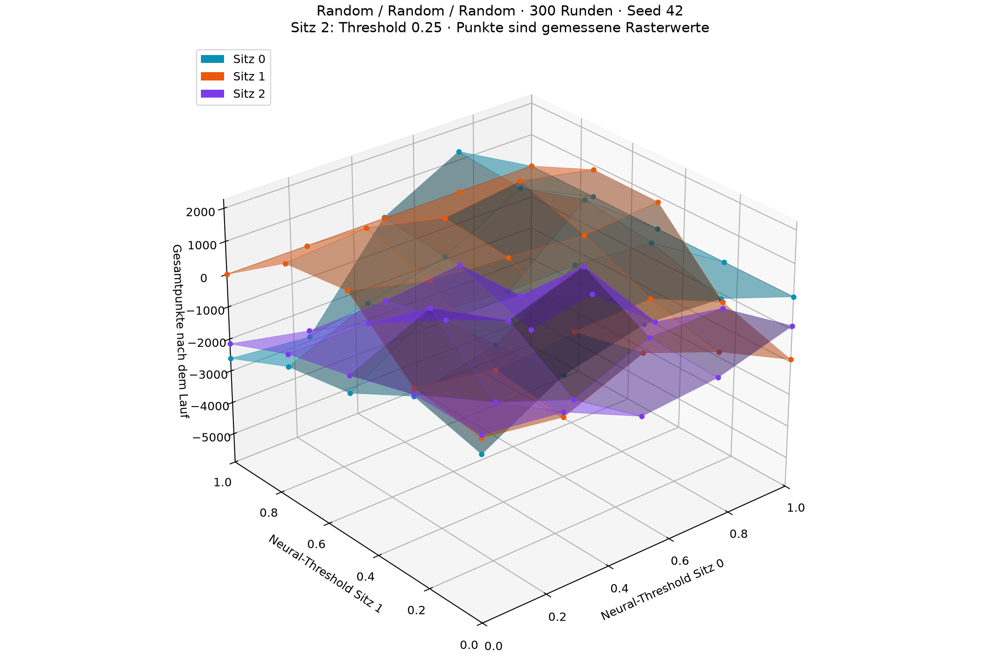
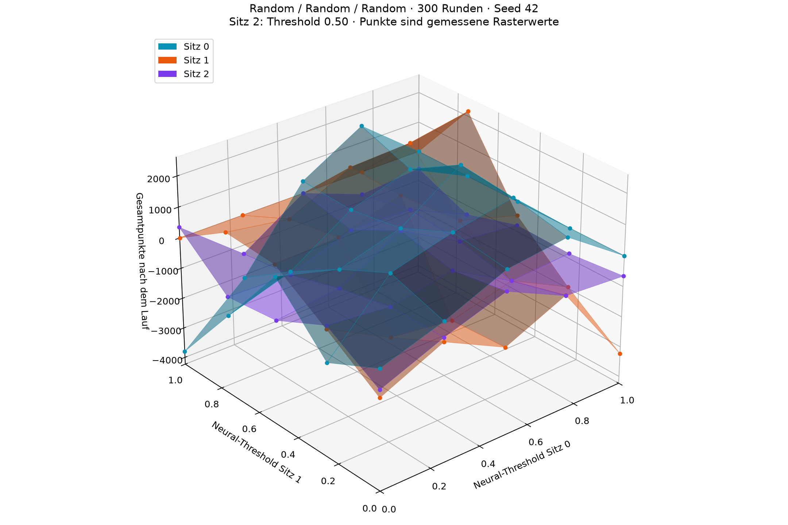
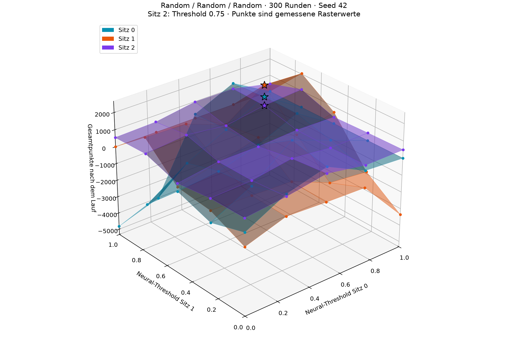
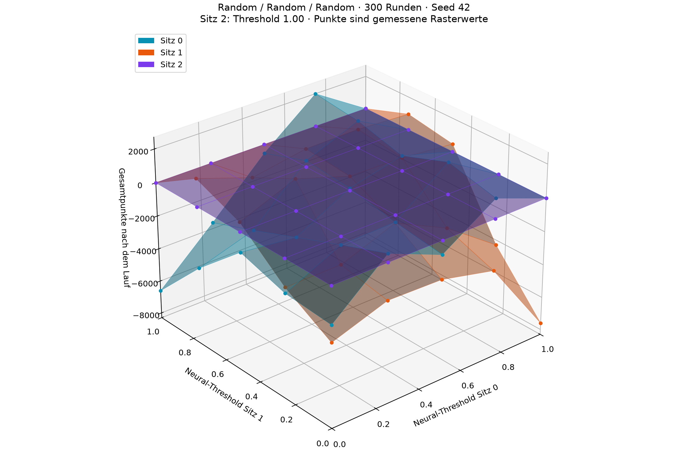

# Gemeinsamer Threshold-Sweep: Random / Random / Random

300 ausgeteilte Runden je Kombination, Seed 42. Alle drei Sitze reizen neural mit ihrer eigenen Schwelle. Die Baseline reizt an allen Sitzen konservativ.

## Punkteflächen der ausgewählten Kombination

Die x- und y-Achsen sind die Schwellen von Sitz 0 und 1. Die Höhe zeigt Gesamtpunkte. Die Schwelle von Sitz 2 steht im Titel und bleibt in dieser Ansicht fest. Sterne markieren die ausgewählte Kombination.

## Siege, Niederlagen und Gesamtpunkte

| Sitz | Bidder / Threshold | Gesamtpunkte | Siege | Niederlagen | Eingepasst | Solo gewonnen / gespielt |
| --- | --- | ---: | ---: | ---: | ---: | ---: |
| 0 | conservative | -956 | 127 | 155 | 18 | 57 / 94 |
| 0 | neural / 0.70 | +1615 | 96 | 136 | 68 | 73 / 94 |
| 1 | conservative | -989 | 121 | 161 | 18 | 50 / 86 |
| 1 | neural / 0.65 | +2309 | 106 | 126 | 68 | 81 / 100 |
| 2 | conservative | -124 | 141 | 141 | 18 | 68 / 102 |
| 2 | neural / 0.80 | +1053 | 74 | 158 | 68 | 34 / 38 |

Siege zählen Parteisiege als Alleinspieler oder Gegenspieler. Eingepasste Runden sind keine Niederlagen. Offizielle Spielpunkte erhält nur der Alleinspieler; im Gegenspiel gibt es in dieser Wertung null Punkte.

## Beste Antworten und Stabilität

Ein Schnittpunkt der Punkteflächen bedeutet gleiche Punktzahlen. Ein Gleichgewicht erfordert dagegen, dass kein Sitz durch Änderung nur seiner eigenen Schwelle seinen Wert erhöhen kann.

Suchstatus: **update limit reached**. Zielgröße: **game_points**.

Die Auswahl minimiert den größten einseitigen Verbesserungsgewinn unter den vollständig geprüften Suchprofilen. Sie maximiert nicht die Summe der drei Punktzahlen.

| Sitz | Gewählter Threshold | Beste Antwort auf Suchdeals | Verbesserung durch Abweichen |
| --- | ---: | ---: | ---: |
| 0 | 0.70 | 0.80 | +24 |
| 1 | 0.65 | 0.65 | +0 |
| 2 | 0.80 | 0.80 | +0 |

## Prüfung auf neuen Deals

Auf Seed 43 wird die ausgewählte Kombination unverändert getestet und für jeden Sitz werden erneut alle 0.05-Schwellen gegen die festgehaltenen Gegner geprüft.

| Sitz | Gewählter Threshold | Beste Antwort auf neuen Deals | Verbesserung durch Abweichen |
| --- | ---: | ---: | ---: |
| 0 | 0.70 | 0.75 | +930 |
| 1 | 0.65 | 0.75 | +1058 |
| 2 | 0.80 | 0.55 | +498 |

Auf neuen Deals beträgt der größte gemessene einseitige Verbesserungsgewinn **1058** (game_points). Die ausgewählte Kombination ist damit auf diesen Deals kein empirisches Gleichgewicht.

Diese Suche optimiert Gesamtpunkte, nicht die absolute Anzahl der Parteisiege. Beide Ziele können verschiedene Schwellen bevorzugen. Mehr eingepasste Runden reduzieren die Zahl ausgespielter Runden; die Siege/Niederlagen und Solo-Ergebnisse sind deshalb vollständig mit angegeben. Für eine Suche nach möglichst vielen Parteisiegen kann derselbe Versuch mit `--objective wins` ausgeführt werden.

Das Ergebnis ist eine empirische Rasteruntersuchung mit endlicher Stichprobe. Das grobe gemeinsame Raster und die feinen einseitigen Antworten decken nicht alle 9.261 feinen Kombinationen ab. Ein beständiges Optimum oder ein Nash-Gleichgewicht im vollständigen Skat ist damit nicht bewiesen.

## Gemeinsame Rasteransichten

### Threshold Sitz 2 = 0.00

### Threshold Sitz 2 = 0.25

### Threshold Sitz 2 = 0.50

### Threshold Sitz 2 = 0.75

### Threshold Sitz 2 = 1.00

